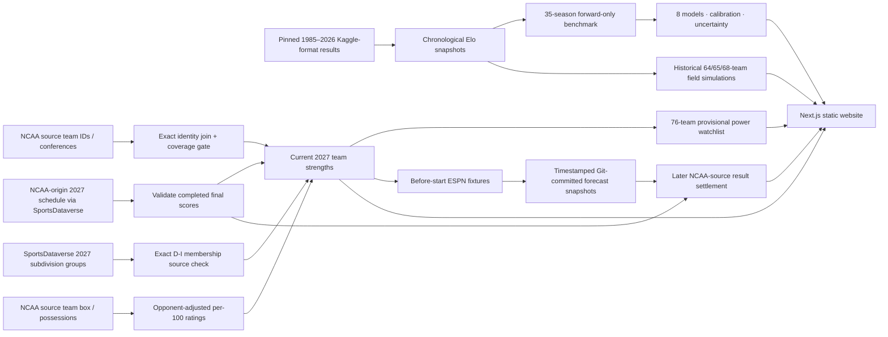

# MARCH FORECAST

**Know the numbers. Question the models. Forecast the madness.**

[](https://github.com/dokeefe414/March-Madness-Forecasting26-27/actions/workflows/ci.yml)
[](https://github.com/dokeefe414/March-Madness-Forecasting26-27/actions/workflows/deploy-pages.yml)
[](https://github.com/dokeefe414/March-Madness-Forecasting26-27/actions/workflows/monitor-archive.yml)


### [OPEN GAME CENTER — FIND A REAL GAME](https://dokeefe414.github.io/March-Madness-Forecasting26-27/)

[Find a Game](https://dokeefe414.github.io/March-Madness-Forecasting26-27/?view=games) · [Real Accuracy & Picks](https://dokeefe414.github.io/March-Madness-Forecasting26-27/?view=predictions) · [Model Lab](https://dokeefe414.github.io/March-Madness-Forecasting26-27/?view=models) · [v0.9 model science](docs/v09-model-validation.md) · [v0.9 operations](docs/v09-forecast-operations.md) · [Game Center](docs/game-center.md) · [Forward accuracy](docs/forward-performance.md) · [State-space research](docs/state-space.md) · [Research models](docs/model-zoo-v06.md) · [Nightly outcome retraining](docs/online-retraining.md) · [Per-game Elo mathematics](docs/game-aware-elo.md) · [v2.2 forecasting intelligence](docs/v22-forecast-intelligence.md) · [Automation recovery runbook](docs/nightly-recovery-2026-11-18.md) · [Daily ESPN finals and NCAA lag](docs/daily-games-2026-11-19.md) · [v2.5 daily Elo reconciliation](docs/daily-elo-2026-11-19.md) · [Weekly AP-vs-Elo method](docs/ap-poll-weekly.md) · [Elo 2.0 research methodology](docs/elo-v2-research.md) · [Data quality](docs/identity-and-conferences.md) · [Pregame audit + integrity checks](docs/forecast-audit.md) · [2027 field watchlist](docs/selection-watchlist.md) · [Architecture](docs/architecture.md)

March Forecast is an open-source NCAA men's basketball forecasting and model-evaluation platform. It combines **current source-backed 2026–27 results**, season-by-season rating trajectories, **eight explicitly evaluated forecasting algorithms**, true possession-based team metrics where NCAA box scores exist, a 76-team field-watch scenario, source-timestamped pretipoff prediction tracking, and a historically grounded tournament simulator. The experience is a bespoke, responsive, dark-themed sports analytics studio.

> **Scientific trust is part of the product.** Actual results, historical backtests, NCAA-source team/conference membership, hypothetical selection scenarios, and future pretipoff predictions always have different labels. No invented March participants or scores. No "D-I certified" label from a name match. No promise that a more complex model will win.

---

## Model strengthening: promotion-readiness audit — November 25, 2026

A new read-only, fail-closed model readiness report evaluates each archived
first-pick challenger against paired Elo using settled-game sample size,
independent dates, Brier improvement and date-block uncertainty. It explicitly
blocks promotion without independently certified candidate calibration,
historical robustness and verified prediction coverage. Production Elo and
immutable forecasts are unchanged. Run
`python -m research.forecast.model_readiness` and
`python -m unittest research.tests.test_model_readiness`.
See [implementation, safeguards and six-stage strengthening plan](docs/model-strengthening-2026-11-25.md).

## Same-day prediction coverage fix — November 23, 2026

Upcoming games on a day with an earlier published final no longer disappear
just because the latest full-day Elo included that result. Both the immutable
forecast recorder and Game Center now re-evaluate game-aware Elo **strictly on
previous-date scored games** using a matching source retrieval. The pregame
probability and displayed team rating/record come from the same safe replay.
No same-day outcome or possession statistic is used as hindsight; experimental
score projections may abstain. A missing scored-game ledger fails closed,
while unmatched school IDs remain explicitly pending. Existing prediction
snapshots and settlements are never rewritten.

[Coverage/replay contract](docs/game-center.md).

---

## v2.7 — Elo Reimagined: real prior-year learning, causal schedule strength and held-out evidence

The new **[Elo Reimagined research studio](https://dokeefe414.github.io/March-Madness-Forecasting26-27/?view=models#elo-v2-comparison)** inside Model Lab tests whether the existing 2027 Elo—which starts every team at 1500—would improve with historical initial strengths and stricter schedule context. This is a **research challenger, not a replacement of the active model**.

Four improvements were implemented and independently compared:

1. **Historical starting ratings.** Carry over 55% of a school's previous-season Elo deviation from 1500, capped at ±160, with a neutral fallback when no verified prior exists. For the actual 2027 research rankings, the *pinned 2026 source is incomplete (Kaggle day 118)* and only strict exact-name matches are available—not an independently verified cross-year ID. That limitation **blocks automatic production promotion** and is visible in the dashboard.
2. **Stronger schedule context without hindsight.** The existing model already considers game-time opponent strength. The challenger additionally tests a **small, shrunken and capped prior-opponent schedule signal**: 16% of previously faced opponents' game-date-frozen Elo deviation, reduced by prior games+6 and clipped to ±35. No future or same-day result leaks into the earlier prediction.
3. **True season-by-season historical experiments.** Replays the source-pinned Kaggle **2016–2025 regular-season games**, using genuine prior-year *same Kaggle team IDs*, on the **same fixtures and previous-date cutoff** for four configurations: original Elo, carryover-only, schedule-only and combined Elo 2.0. Tracks winner accuracy, Brier score, log loss, five-bin calibration ECE, first-45-days evidence, season-by-season gains and season-block 95% descriptive intervals. These are **fixed-policy out-of-season tests**, not retrospectively claimed first-published forecasts.
4. **A three-view comparison dashboard.** Model Lab now offers **Current Rankings** (original vs shadow Elo on the same source-verified Division I cohort), **Historical Tests** (paired performance and uncertainty) and **Elo 2.0 vs AP** (original *frozen* weekly AP comparison vs the new *retrospective*, Sunday-cutoff Elo 2.0 ranking). Shows source date, matched prior coverage, gaps, missing data and model-promotion status without adding another site navigation tab.

**No live prediction or accuracy manipulation:** The operating game-aware Elo, immutable before-tipoff probabilities, ESPN+NCAA settlement, existing archive/Pages schedules and manual model-promotion gate remain unchanged. Better AP agreement alone is not evidence of better winner predictions. Historical raw source availability and identity limitations are disclosed; unavailable data does not produce invented improvements.

[Mathematics, source provenance, pairing contract, tests and evaluation results](docs/elo-v2-research.md) · [Model Lab](https://dokeefe414.github.io/March-Madness-Forecasting26-27/?view=models#elo-v2-comparison).

---

## v2.6 — AP Top 25 versus Elo: a new independent weekly comparison

**New feature:** Every week, [Model Lab](https://dokeefe414.github.io/March-Madness-Forecasting26-27/?view=models#ap-elo-comparison) compares the 2026–27 Associated Press **men's Top 25** against our own current-season game-aware Elo rankings, using the AP poll carried by ESPN. Historical comparisons accumulate for the season; **no existing main navigation tab is added**.

The dashboard includes **Top-25 overlap, Top-10 overlap, average absolute rank gap, Spearman rank agreement, the full 25-school side-by-side leaderboard, Elo Top-25 outsiders, and a selectable week-by-week trend**. Team matches require independently source-linked season-2027 ESPN IDs, not guessed school names; missing matches are explicitly shown rather than assigned invented ranks.

**A fair comparison:** a poll for week starting Monday is matched to the Elo model **replayed only on games dated through the preceding Sunday**. The first successfully captured comparison for a poll week is frozen in Git (`web/public/research/ap-poll-history.json`), preventing later results or backfilled data from rewriting old agreement numbers. This is a game-date-frozen study, not a retroactive claim that the data was available precisely at poll publication time.

**Automatic update:** the archive checks for new AP poll editions on its existing daily schedule, with a dedicated **Monday 6:07 PM Eastern poll archive** and **6:47 PM Eastern website publication**. If the AP provider hasn't released the new edition yet, scheduled retries will check again; existing comparisons are preserved. Missing or incomplete polls never break daily Elo updates or public first-pick grading.

**Scientific boundary:** AP voters are not an independent game-result ground truth. Greater agreement with the poll does **not** prove lower future Brier error; models are never trained or auto-promoted simply to imitate the AP ranking. Real forecasting skill is still measured from the immutable, independently settled pregame predictions.

[Full AP source, ranking mathematics, fairness policy, GitHub schedule and testing](docs/ap-poll-weekly.md) · [Model Lab](https://dokeefe414.github.io/March-Madness-Forecasting26-27/?view=models#ap-elo-comparison).

---

## v2.5 — Actual daily Elo learning when the NCAA file is behind

**This fixes the game-to-model pipeline, not just the scoreboard.** The 2026–27 season Elo originally read only the delayed NCAA-derived SportsDataverse schedule, so a successful nightly deployment could have exactly the same ratings as the previous day. From v2.5 forward, each scheduled archive and Pages build also examines the last seven Eastern calendar days of ESPN results. Games must be **STATUS_FINAL, completed=true**, have two valid unequal final scores and both schools must match **independent season-2027 ESPN team IDs** before they can become supplemental Elo training inputs. No guessed school-name linkage.

**Every accepted new game now affects both schools' Elo ratings, wins/losses, and the re-trained research models and future forecast probabilities.** The score-margin/strength/venue-aware Elo replay continues to be deterministic. The archive commits verified ESPN-final *score receipts* under `web/public/forecasts/espn-final-receipts.json`, so a result remains known even if its ESPN scoreboard date falls out of the 7-day window. When the NCAA file finally reports the game, its team pair, scores, and date are reconciled and **the win is counted only once**. Contradictory or ambiguous ESPN/NCAA results are withheld rather than silently trusted.

**You can see what really updated:** the Game Center displays the latest rating date, the last NCAA-only scored date, ESPN-only games already included in Elo, and games waiting on identity/source verification. `sourceReconciliation` reports the exact counts, conflicts and source warnings. The source-method version is explicitly `source-aware-game-elo-v2-espn-final`; earlier published predictions remain immutable. Official accuracy still requires an independently matching ESPN final **and** NCAA final; ESPN-only scores cannot inflate right/wrong picks.

**Important:** Adding yesterday's games makes forecasts more current, but retraining and increased Elo sample size do not guarantee better accuracy. The site's original first-pick evidence, Brier score and calibration must justify any model change; challenger model adoption remains manual. This is scheduled after-game learning, not instant buzzer-to-rating streaming.

[Technical source reconciliation, leak-free archiving, tests and recovery guide](docs/daily-elo-2026-11-19.md) · [v2.4 score display](docs/daily-games-2026-11-19.md) · [daily workflow schedule](docs/v09-forecast-operations.md).

---

## v2.4 — Daily completed games, faster nightly updates and refreshable Game Center

**Why games looked stuck even while automation was green:** on Nov 19, the latest successful website build had processed 953 NCAA-derived scored games, but that particular provider release contained game results only through Nov 18. Also, the Find a Game list deliberately showed **future games only**, hiding completed ones, and a browser tab did not re-fetch data after a deployment.

**What's fixed:**
- A new **Recent Finals** scoreboard on the existing **Find a Game** page shows strictly ESPN **STATUS_FINAL + completed=true** games, latest scores and dates from a four-day Eastern window, even when the NCAA-derived model feed is running behind. It clearly distinguishes ESPN-confirmed results from results actually accepted into Elo; it never silently changes Elo or the official immutable prediction archive.
- The Game Center now **refreshes published data every ten minutes, whenever you return to the tab, and with a visible refresh button**. It fetches fresh static JSON while retaining selected games and saved team filters when those records remain available.
- Added a **10:07 p.m. Eastern pretipoff archive/settlement pass**, a **10:47 p.m. Eastern website build** and a **11:41 p.m. Eastern watchdog** during the season, in addition to overnight, morning and afternoon updates. This reduces evening gaps but does not guarantee instant buzzer-to-browser publishing.
- Source retrieval timestamps and scores remain transparent. A finished ESPN game without a matching accepted NCAA source result is visible as a final, **not falsely counted as new Elo training data or a graded correct/missed prediction**.

The two independent clocks are intentional: **ESPN verified final-score display** can be newer than **NCAA-accepted Elo and settlement evidence**. The [daily source separation and operations runbook](docs/daily-games-2026-11-19.md) explains exactly what updates when, how missing source days are handled, and how to reproduce the tests.

---

## v2.3 — Automatic archive recovery and duplicate-proof GitHub Pages deployment

**The fix is operational, not cosmetic.** After the Nov 18 release, GitHub Actions showed two genuine failures: a missed scheduled archival capture (detected by the monitor) and a scheduled Pages build that uploaded a correct artifact but whose downstream deployment step initially could not see it. Retrying that SAME failed Pages job produced a duplicate artifact under one workflow ID, revealing why naive "rerun failed jobs" is the wrong recovery strategy.

- **Re-registered archive schedules:** independent 02:07, 06:07, 09:07 and 16:07 Eastern expressions in November–April, each rebuilding source-backed Elo, retraining, freezing only valid *future* original predictions and settling *independently verified* past finals. Archive captures remain immutably committed and never forced.
- **Self-healing archive watchdog:** 03:41, 07:41, 11:41 and 18:41 Eastern, plus a check after successful Pages runs. If committed archive evidence is over four hours old, the watchdog checks for an existing active archiver and sends a narrowly permissioned `workflow_dispatch` if none is running. The incident remains visible until a later *successful* capture and ledger audit, then the old issue automatically closes.
- **Safe Pages artifact propagation:** after building, the deployment polls GitHub's Actions artifact API for exactly one uploaded `github-pages` artifact and waits briefly for replication. Downstream Pages retries are longer and bounded; missing or duplicate artifacts cause a clear failure, never a false success.
- **New independent Pages recovery:** if only the Pages deployment step fails and the original run uploaded exactly one artifact, a separate workflow dispatches a **fresh site build under a new run ID**. It never reruns the same artifact-upload job, loops on a dispatched retry, or conceals data/model failures.
- **Tests and complete runbook:** schedule sequencing, recovery guardrails, no-force archive behavior, token scopes, and four-hour freshness thresholds have regression checks in the standard Python CI suite. Source/final-state rules, research-only promotion policy and frozen original pick history are unchanged.

GitHub Actions remains a best-effort scheduler; no solution based only on cron can guarantee an immediate postgame update or eliminate third-party outages. We report actual workflow and archive health rather than promising flawless automation. [Incident evidence, self-recovery design and validation](docs/nightly-recovery-2026-11-18.md) · [Operations schedule](docs/v09-forecast-operations.md).

---

## v2.2 — Forecast Intelligence: learn from the right games, earn better probabilities

**Research depth upgraded without hiding any results.** The 2026–27 pipeline now saves a strictly source-matched, **two-sided NCAA team-box game artifact** for actual ORTG, DRTG and possession data. A new regularized efficiency model learns from opponent-adjusted team strengths, recent possession quality, schedule strength and rest, and uses optional shooting/rebounding/turnover/Four Factors only when actually sourced. Teams need three prior paired box games before their feature vector is eligible; all date-D results are embargoed until after that date's test predictions. When the optional data is missing, the research transparently abstains, and the existing live Elo keeps running.

**Better prior-season training:** The established six-model historical tournament championship now also evaluates a conservative **prior-year-only stack**. Each historical test season uses a model and convex weight chosen from previous unseen tournament seasons, with a minimum evidence floor and season-block uncertainty. The original historical champion policy and all live current-season picks remain unchanged. We do not pretend historical team IDs or missing box data can be automatically transplanted into 2027.

**Adaptive weighting without cheating:** The ensemble research now tests date-by-date blending weights learned only from earlier independently settled original-component predictions **whose final verification was published before the later forecast**. Reconstructed prequential research and genuinely frozen first-pick ensemble performance are deliberately labeled separately. Nothing is automatically promoted based on attractive retrospective results.

**Live prediction-quality monitoring:** Original-first-pick confidence reliability bands, descriptive expected calibration error and separate Elo-formula-version results make overconfidence and genuine improvement easier to inspect. Pending source results remain pending—not incorrect. Older frozen probabilities are never rewritten.

**Premium Forecast Studio:** The [Model Lab](https://dokeefe414.github.io/March-Madness-Forecasting26-27/?view=models) gains a responsive editorial research cockpit with verified evidence counts, accessible tabs for efficiency/adaptive/historical experiments, paired Brier bars that show **negative as well as positive** gains, and actual first-pick calibration graphics. The core five-tab website navigation stays simple.

**Automation remains hands-off:** The already configured nightly/catch-up GitHub Actions pipeline now generates `2027-box-games.json` and `efficiency-research.json` alongside the other models. This is a scheduled sourced-data refresh, **not** instantaneous buzzer-to-Elo processing. New models are research-only until genuine independently archived forward evidence warrants manual evaluation.

[Read the v2.2 model equations, exact source contract, chronology guards, operating steps and UI specification](docs/v22-forecast-intelligence.md) · [Elo v2.1](docs/game-aware-elo.md) · [Daily automation](docs/v09-forecast-operations.md).

---

## v2.1 — Every scored game moves Elo, with opponent strength and capped scoring margin

**Automatically recomputed after every source refresh:** Each accepted 2026–27 score changes both teams' published Elo, using the **opponent's previous rating**, the source-designated home/away context, and the **actual score margin**. The update is zero-sum and caps blowout influence: effective `K = 24 × (0.85 + 0.65 × min(1, log(1 + margin) / log(26)))`, so a 25-point win and a 50-point win have the same capped multiplier. Every contest has an auditable signed Elo movement, source ID, pregame rating and date. The team page shows the last five changes and each opponent's Elo *at game time*, instead of misusing the opponent's later rating.

**More useful without leaking future results:** All games on one calendar date receive probabilities from the ratings **at the start of that date**; afterwards, their individual rating updates are applied. The source lacks verifiable true same-day tipoff order, so this is more defensible than pretending the CSV sort order is actual game time. The regularized logistic challenger now updates its internal team histories with the **same** source-aware Elo rule; historical tournament baselines and immutable pretipoff forecasts remain preserved.

**Prove improvement, don't assume it:** Both classic Elo and margin-aware Elo are replayed on identical previous-date games. The season dashboard shows their paired Brier errors, accuracy and improvement (which can be negative). This heuristic is not automatically better; do not interpret retrospective accuracy as live-first-pick success. Injury/lineup/travel data, authoritative neutral-site status and universal verified possessions are **not** in the score feed and are not invented. Game scores can also lag publication. Ratings update on the site's scheduled refreshes, **not instantaneously at each buzzer**.

Details: [game-aware Elo equations, update receipts and limitations](docs/game-aware-elo.md) · [current-season source contract](docs/current-season.md) · [nightly source/retraining pipeline](docs/online-retraining.md).

---

## v2.0 — Basketball intelligence, historical model championship, richer brackets and My Teams

**Six historically trained/tested challengers** now compete on the *same* source-pinned NCAA tournament games. The [Model Lab](https://dokeefe414.github.io/March-Madness-Forecasting26-27/?view=models) shows Elo, regularized logistic regression, gradient-boosted decision stumps, earlier-year calibrated Elo, the regularized scoring-margin model, and a fixed prior-shrunk Elo control. Every evaluated tournament season is **unseen during fitting**; the nested champion is chosen only from **previously held-out earlier seasons**, with paired Brier/log loss/accuracy and season-block uncertainty. The active live model is unchanged.

**Verified-feature pipeline:** `forecast.historical_box_store` can ingest actual NCAA event-level two-sided box scores to compute possessions, efficiency, eFG%, turnover rate, offensive rebounding, free-throw rate, pace and a descriptive strength-of-schedule proxy. It enforces source team IDs, before-tournament cutoffs, duplicate controls, plausible raw statistics and SHA-256 provenance. **Important: no full historical NCAA box-score file has been supplied in this repository, so the published coverage report honestly shows missing Four Factors rather than inventing them.** The current model championship trains on the previously verified pre-tournament Elo/win-loss features until source-complete possessions exist.

**Brackets, beyond champion picks:** [Bracket Lab](https://dokeefe414.github.io/March-Madness-Forecasting26-27/?view=bracket) now shows expected tournament wins, 95% **simulation-sampling** intervals on championship probability, and clearly labeled first-round upset scenarios that do not guess play-in winners. Reproducible seeded Monte Carlo respects the actual historical 64/65/68 entrants (and can process a properly sourced future 76-team field). It does not claim to know the official 2027 field.

**My Teams watchlist:** [Game Center](https://dokeefe414.github.io/March-Madness-Forecasting26-27/?view=games) lets you follow up to 12 programs, quickly open their future listed ESPN fixtures, star/unstar either side of a matchup, and filter to your teams. Favorites are saved only in that browser, without a login or change to public forecasts. All five top-level navigation destinations and hidden legacy pages remain intact.

**Production safety:** No modification to current active Elo, original pretipoff snapshots, source-verification settlement records, or archived historical predictions. Research is evaluated separately from genuinely frozen live first-picks. CI validates real historical seasons, data provenance, no-leakage model selection, bracket integrity and browser/mobile usability. See the [complete v2.0 implementation and math](docs/v20-basketball-intelligence.md).

---

## v1.9 — Verified prediction performance, first-pick score research and faster game navigation

The [Accuracy & Picks](https://dokeefe414.github.io/March-Madness-Forecasting26-27/?view=predictions) page now has an original-first-pick accuracy center: **daily and weekly winners, Brier, paired Elo-vs-shadow experiments, source-verified settlement status, delayed-game triage, and actual margin/total error only once an original archived score prediction settles**. Pending is never mislabeled an incorrect pick; unverifiable final scores are withheld.

**Research scoring is now captured before future tipoffs.** New archived predictions can contain an optional research-only projected home/away score, signed margin, total and source provenance based on actual opponent-adjusted possession rates where verified, or a clearly labeled scoring-mean fallback. Older first-pick records are never retroactively filled in. Its future score accuracy is evaluated independently of active Elo winner probability, and cannot be presented as a sportsbook line or a validated live interval.

The [Game Center](https://dokeefe414.github.io/March-Madness-Forecasting26-27/?view=games) now shows the selected favorite and research-model agreement at a glance, with a direct jump to the detailed matchup. All historical and model-research pages remain accessible through the simplified five-tab + More navigation.

**Scientific guardrails:** Only the earliest immutable pretipoff forecast for an ESPN event and an independently matched ESPN/NCAA final can contribute to outcomes. Original winner probabilities, the live model selection policy, and existing immutable snapshots and settlements remain untouched. Comparisons use paired original games with date-block uncertainty, and no candidate is automatically promoted.

Read [v1.9 verified accuracy and scoring methodology](docs/v19-verified-accuracy-and-score-research.md). Tests cover source identity, chronology, score-data abstention, pending status and no retroactive evaluation.

---

## v1.8 — Better historical models, probability reliability and simpler navigation

**The app now has only five primary navigation destinations:** **Find a Game**, **Teams**, **Bracket**, **Accuracy & Picks**, and **Model Lab**. All seven other workspaces remain available under the organized **More** menu (This Season / History & Research); every existing `?view=` deep link still works, with a breadcrumb and Back to Games shortcut. Mobile no longer duplicates multiple rows of competing tab bars.

**New independent historical scoring study:** a source-pinned, regularized signed margin and total-points model evaluates predicted scores and Gaussian 80% interval *coverage* using historical tournament years held out chronologically. Probabilities derived from the score margin are assessed against Elo using Brier, log loss, accuracy and ten-bin calibration. A conservative second-layer ensemble learns weights and a probability scale only from **earlier out-of-time** tournament seasons. The [Model Lab](https://dokeefe414.github.io/March-Madness-Forecasting26-27/?view=models) displays year-level results and evidence, not invented accuracy.

**Clearer game explanations:** The [Game Center](https://dokeefe414.github.io/March-Madness-Forecasting26-27/?view=games) includes a collapsed explanation of why active Elo win probabilities, experimental projected scores, and frozen ensemble challenger probabilities might disagree.

**Critical scientific boundary:** Historical source features are **day-132 pre-tournament ratings**, not date-frozen inputs for each regular-season game. These research scores and intervals are **not** automatically deployed to live 2026–27 predictions. Production Elo, pre-tipoff recording and immutable settlements remain untouched. CI builds and verifies separate, reproducible source-matched historical reports.

See the [v1.8 technical methodology and compact navigation guide](docs/v18-probabilistic-models-and-navigation.md).

---

## v1.7 — Audited historical training dataset and nested unseen-season research

A new independent research pipeline validates and exports historical NCAA tournament matchups against season-specific *pre-tournament* team ratings, with source commit and SHA-256 proofs, complete-season eligibility, duplicate detection, missing-team exclusions, and deterministic winner-independent feature orientation. **No incomplete historical season is fabricated or used to train a supposedly complete bracket.**

It compares original Elo, earlier-year calibrated Elo and a nested previously-held-out-season-selected option on exactly the same games. Training and selection are strictly from **earlier tournament years**, with transparent Brier, log loss, winner accuracy and season-block uncertainty. The [Model Lab](https://dokeefe414.github.io/March-Madness-Forecasting26-27/?view=models) reports actual eligible source coverage and year-by-year held-out results. CI preserves the machine-readable source manifests, evaluation and optional training rows for reproducibility.

**Existing original pregame forecasts remain untouched.** The new historical features do not represent per-game regular-season tipoff states, and this historical experiment does not justify automatically promoting a 2027 model.

Read [v1.7 historical data and nested evaluation methods](docs/v17-historical-evaluation.md).

---

## v1.6 — Original pregame-frozen ensemble, source-verified comparison and rigorous promotion gates

**New forward-first challenger:** the public site now tests a *conservative shadow ensemble* of previously fitted current-season logistic, state-space, opponent-aware and adaptive strength models with Elo. The scheduled pre-tipoff recorder archives the ensemble probability, component count and weight alongside the original active pick. It **never rewrites earlier forecasts or automatically declares the ensemble more accurate**.

**Fairer comparisons:** the Model Lab distinguishes an earlier-date historical recombination of already frozen research signals from a **real prospective score of the exact originally archived ensemble probability**, using ESPN/NCAA independently verified final results on the identical first-picked fixtures. To be eligible for scientific review, a challenger requires a positive out-of-time date-block uncertainty result *and* at least 100 independently settled original portfolio predictions across 12 dates showing a Brier advantage over Elo. Missing source outcomes mean no claim, not a zero loss or perfect score.

**Safeguards:** date-scoped model training, source-capture timestamps, existing 15-minute before-listed-tipoff buffer, finite probability checks, source-provenance agreement, immutable unique-first-pick scoring, and no production model promotion without explicit review. The established Elo winner forecast continues to be the public default while evidence accumulates.

Read the [v1.6 forward ensemble mathematical and operations guide](docs/v16-forward-ensemble.md), use the [Model Lab](https://dokeefe414.github.io/March-Madness-Forecasting26-27/?view=models), or inspect the original [forecast archive](web/public/forecasts).

---

## v1.5 — Stronger basketball scoring models and honest out-of-time evidence

**What improved:** the [Game Center](https://dokeefe414.github.io/March-Madness-Forecasting26-27/?view=games) now prefers source-verified **opponent-adjusted points per 100 possessions and real pace** for projected scores, margins and totals when the NCAA-derived box-score pipeline has enough verified games for both teams. Insufficient/partial data is explicitly labeled and falls back to the previously verified simple scoring-average calculation without inventing possessions. These are descriptive score estimates, not a betting line or an independently calibrated margin distribution.

**Prove it:** the [Model Lab](https://dokeefe414.github.io/March-Madness-Forecasting26-27/?view=models) now includes a chronological, previous-game-date-only scoring experiment comparing an independent ridge-regularized opponent-adjusted score model to raw scoring means on identical source final games, reporting both scoring MAE and Brier. The source score-only backtest is **not mislabeled a possession experiment**. No results are claimed if evidence is unavailable or performance is not improved. Existing Elo winner probabilities remain active; this experiment does not retroactively change any pre-tipoff predictions.

Mathematics, source eligibility gates, validation caveats, tests and roadmap: [v1.5 causal score and efficiency guide](docs/v15-causal-scoring-model.md).

---

## Verified winners, misses, and an experimental score/spread projection

The [Accuracy & Picks](https://dokeefe414.github.io/March-Madness-Forecasting26-27/?view=predictions) workspace now shows **each correctly predicted or missed winner** as a source-verified first-pick receipt: actual final score, original pre-tipoff favorite and confidence, outcome, model, timestamp and Brier. Filter by **correct**, **missed**, **even-odds**, or all independently settled games. Repeat captures of one ESPN game are never counted as independent successes.

The [Game Center](https://dokeefe414.github.io/March-Madness-Forecasting26-27/?view=games) now also features an experimental **projected final score, projected spread and combined total**, computed from each team's actual source-recorded scoring/conceding averages. This is a **descriptive neutral-court baseline—not a sportsbook line, a validated betting system, or a calibrated margin model**. It requires five verified previous games per team and never makes up scores for missing data; current Elo win probabilities remain separate.

Forecast archives now run at **2:07 a.m., 6:07 a.m., 9:07 a.m. and 4:07 p.m. Eastern** in basketball months, with overnight verified-final settlement before **2:47/6:47 a.m.** Pages refreshes. The site separately refreshes at **10:17 a.m. and 5:17 p.m.** This is **not a live buzzer-to-website feed**: independently matched NCAA and ESPN finals must exist before it claims correct/missed results. No completed fixture can be labeled with a newly generated "pregame" forecast. See [verified results and score projection specification](docs/pick-results-and-score-projection.md).

---

## v1.3 — Forecast reliability, learned research challengers and two-player brackets

**Start here:** [Live Game Center](https://dokeefe414.github.io/March-Madness-Forecasting26-27/?view=games) · [Operations & immutable picks](https://dokeefe414.github.io/March-Madness-Forecasting26-27/?view=predictions) · [Scientific Model Lab](https://dokeefe414.github.io/March-Madness-Forecasting26-27/?view=models) · [Two-player historical bracket duel](https://dokeefe414.github.io/March-Madness-Forecasting26-27/?view=bracket) · [Team Intel](https://dokeefe414.github.io/March-Madness-Forecasting26-27/?view=teams).

- **Source-first operational transparency:** source-capture freshness, ESPN coverage, repeated immutable snapshots, pending independently verified finals, and observed changed scheduled start times appear in an accessible Operations Center. Re-scheduled/canceled statuses are never guessed; the original first-pick evidence remains immutable.
- **Substantial new ML research:** actual fitted, previous-date **12-tree depth-two gradient-boosted CART**, with explicit fixed regularization and refits; plus a sequential **approximate Gaussian Bayesian Bradley–Terry** team-strength filter. Both are scored against Elo on identical date-frozen retrospective games, and neither can silently become a live model.
- **Head-to-head bracket competition:** independent Player A and Player B picks in the same verified historical seeded bracket, per-round matchup comparison, Elo-favorite reference decisions, local device saving, and optional shareable duel link. No online account or invented 2027 official bracket is involved.
- **Visual research workbench:** date-frozen model error curves, actual archived first-pick rolling error, calibration confidence versus wins, and interactive team Elo-strength trajectories with distinct evidence labels.
- **Mobile/polish:** quick large-tap Games/Teams/Accuracy/Brackets shortcuts, deep links and working browser back/forward, responsive source evidence cards, preserved PWA support and keyboard navigation.

**Read the mathematical definitions, limitations, operations recovery procedures and verification:** [v1.3 research + tournament operations guide](docs/v13-research-tournament-operations.md). CI tests code; real-world predictive improvement must be earned on independent future-game predictions and verified finals, not inferred from historical backtests.

---

## v1.2 — Verified results, team intelligence, model evidence and bracket building

**Go straight to what matters:** [Today's games](https://dokeefe414.github.io/March-Madness-Forecasting26-27/?view=games) · [Team intelligence](https://dokeefe414.github.io/March-Madness-Forecasting26-27/?view=teams) · [Real prediction accuracy](https://dokeefe414.github.io/March-Madness-Forecasting26-27/?view=predictions) · [Fair model comparisons](https://dokeefe414.github.io/March-Madness-Forecasting26-27/?view=models) · [Build a historical bracket](https://dokeefe414.github.io/March-Madness-Forecasting26-27/?view=bracket).

- **Settlement investigation:** public source-derived backlog separates future, recently started, independently unresolved and 48h+ delayed archived games. The pregame recorder now retries the oldest unresolved fixture dates up to 45 days back with a bounded ESPN budget. It never invents scores or counts prospective picks before a matching, independently verified final.
- **Teams workspace:** searchable, shareable 2026–27 team pages combine actual NCAA results, Elo trajectories, sourced efficiency/pace, recent opponents, and upcoming verified fixtures. Missing source metrics remain blank.
- **Model lab:** a unified table compares actual first-published, source-settled paired model probabilities on the same games, including Brier differences, date-block confidence intervals when the sample supports them, and calibration bins. Original validation gates are preserved.
- **Make your own tournament bracket:** pick play-in and later round winners in a complete sourced historical field; save locally, reset and share a scenario link. This does not fabricate the unselected 2027 NCAA tournament.
- **Accessible mobile/installable site:** responsive cards, stable shareable tabs, keyboard skip navigation and an HTTPS-scoped progressive web app shell. Real forecast JSON is network-only, never served from an offline cache.

**Technical specification and testing:** [v1.2 implementation, data provenance and acceptance criteria](docs/v12-team-and-accuracy.md). Green CI verifies code; only actual source-backed recorded finals verify live forecast outcomes.

---

## v1.1 — Daily basketball intelligence and verified forecast operations

**Live website:** [Open daily forecast desk](https://dokeefe414.github.io/March-Madness-Forecasting26-27/?view=games) · [Real scored picks](https://dokeefe414.github.io/March-Madness-Forecasting26-27/?view=predictions) · [Causal research and drift](https://dokeefe414.github.io/March-Madness-Forecasting26-27/?view=models) · [Road to March](https://dokeefe414.github.io/March-Madness-Forecasting26-27/?view=selection).

- A faster daily front page surfaces today's source-backed future fixtures, strongest favorites, closest model calls, verified archive health and one-tap navigation to detailed matchup receipts.
- Successful archive runs always publish a dated derived manifest with source coverage, even on legitimately empty schedule days. GitHub Pages also rebuilds after a successful archive workflow to shorten the lag before picks are visible. Git pushes retry safely without a force update; monitors distinguish true empty days from missing/stale/partial evidence.
- Two **research-only** current-season causal challengers—Bayesian-style Elo shrinkage and online gradient residual stumps—are independently compared with previous-date Elo on the same previously completed games. No model is automatically promoted.
- Prospective 50-game drift review compares consecutive, nonoverlapping 25-game Brier windows using only independently settled, original pretipoff first picks. Insufficient samples show no numerical claim.
- Road to March highlights source-qualified provisional strength leaders and hypothetical neutral-site Elo peer matchups; no official field, seeds, or championship chances are invented.
- Accessibility improvements: skip link, direct destinations, mobile-first cards and source-freshness notices.

**Validation matters:** a green site deployment is *not* proof that the scheduled pregame recorder has captured and independently settled live games. Inspect the immutable Git ledger and the archive monitor to verify real production evidence. Details, mathematical assumptions, safe recovery and test commands: [v1.1 science + operations](docs/v11-season-intelligence.md).

---

## v1.0 — Prediction intelligence, transparent accuracy and scenario sensitivity

**What is new:** The real Game Center now exposes a source-grounded **team-vs-team strength and adjusted-efficiency comparison** with honest missing-data handling. `Accuracy & Picks` includes **exclusive favorite confidence cohorts**, **25-game chronological forward Brier**, and **Brier skill relative to a 50/50 reference** (including negative results when the public forecasts underperform). The historical Bracket Lab offers a **one-team ±150 Elo sensitivity experiment** with same-seed, same-run paired Monte Carlo simulations and championship probability deltas.

The underlying predictions and rules remain unchanged unless verified forward results justify a pre-existing gated promotion: no invented 2027 bracket, no results leaked into pregame odds, no fake success rate when zero first-archived forecasts have settled, and no turning descriptive efficiency numbers into coefficients.

**Explore:** [Game evidence](https://dokeefe414.github.io/March-Madness-Forecasting26-27/?view=games) · [Prospective performance](https://dokeefe414.github.io/March-Madness-Forecasting26-27/?view=predictions) · [Bracket sensitivity lab](https://dokeefe414.github.io/March-Madness-Forecasting26-27/?view=bracket) · [Full v1.0 methods, tests and runbook](docs/v10-prediction-intelligence.md).

---

## v0.9 — Prove every real game forecast, then adapt responsibly

The entry screen is still **Find a Game**. Choose a real source-matched future ESPN matchup, search by **school** or select a team directly from **2027 Pulse**, and see:

- The **actual home/away win percentage** and which model supplied the headline forecast.
- Why earlier opponents matter: a team's own sequence of sourced results, pregame Elo, recent form, home-court assumption, common opponents, head-to-head history and a **new opponent-strength-adjusted score-margin candidate**.
- Small season Elo curves for both teams, explicit research-only fixed/adaptive Gaussian probabilities, and whether either latent team is showing **repeated innovation drift-watch** evidence.
- A **shareable `?view=games&game=<ESPN event ID>` deep link** and quick jumps to the independent model lab and honest accuracy history.
- After the game finishes and independent source verification passes, the **original archived percentage next to its real final score**, missed/correct status, Brier score and a chart of how its actual earlier public captures evolved.

**The scorecard cannot manufacture accuracy.** `Accuracy & Picks` uses only the earliest legitimate Git-archived before-tipoff forecast for each unique ESPN event and subsequent finalized source result. There is no success rate until such games have settled; `—` is intentional, not 0% or a perfect record. Model Lab shows real paired same-game Brier/accuracy and distinct retrospective date-frozen experiments without mixing cohorts. Research models are not automatically promoted because an isolated high-confidence favorite lost.

**A missed forecast becomes future information, not a revision of history.** On subsequent scheduled builds, previous-date games update Elo, logistic coefficients and independent opponent-aware/adaptive state-space research. The current Eastern game date remains embargoed. The online logistic model needs *both* chronological out-of-time evaluation **and** at least 40 truly archived first-pick paired games with a prospective Brier advantage before taking over new eligible regular-season games. Opponent-aware and adaptive Kalman variants stay research-only until separately validated; no guaranteed performance gain is claimed.

**Reliability upgrade:** a result is settled only if the NCAA-derived score agrees with an *independently completed ESPN `STATUS_FINAL`* for the very same event ID, scheduled Eastern date, and exact home/away scores. A score mismatch, postponement, unfinished event or missing source stays unscored. The separate archive monitor flags a missing/stale/no-pick ledger and the website displays its state instead of implying success.

**Automated every night, Eastern local time (EST/EDT):** source-verified score settlement at **2:07 a.m.** and **6:07 a.m.** Nov–Apr, site rebuilds at **2:47 a.m.** nightly and **6:47 a.m.** in-season; new morning/evening picks at **9:07 a.m./4:07 p.m.**, site republishing at **10:17 a.m./5:17 p.m.**, and archive-health checks at **7:35 a.m./11:35 a.m./6:35 p.m.** A missing overnight capture is flagged if the last archive is older than six hours. Source or GitHub Actions delays can postpone results; no missing final is invented.

**Quick access:** [Find a real game](https://dokeefe414.github.io/March-Madness-Forecasting26-27/?view=games) · [Real winner accuracy](https://dokeefe414.github.io/March-Madness-Forecasting26-27/?view=predictions) · [Compare models](https://dokeefe414.github.io/March-Madness-Forecasting26-27/?view=models) · [Check public archive health](https://dokeefe414.github.io/March-Madness-Forecasting26-27/current/archive-health.json) · [Read the science](docs/v09-model-validation.md) · [Daily runbook and recovery](docs/v09-forecast-operations.md).

---

## Original v0.6 research foundations (preserved)

| Area | New capability | What it does *not* claim |
| --- | --- | --- |
| **NCAA source identity** | Exact 2027 team ID/conference crosswalk **plus independent 2027 Division I subdivision membership evidence**; matched/unmatched coverage, conference filters | D-I source group membership is verified separately; neither membership nor a conference name certifies individual postseason eligibility |
| **True pace stats** | Opponent-regularized per-100-possession offense, defense, net and pace from real NCAA-derived team box rows | Descriptive efficiency is not yet a historically trained win-probability model |
| **Strong prediction research** | Seven baseline/learned methods plus a prior-year-tuned **probability ensemble**; boosted Elo, causal EWMA, uncertainty, full walk-forward validation | Out-of-time historical results do not guarantee success in the upcoming season |
| **Real pregame evidence** | Scheduled future ESPN fixtures, conservative identity matching, strict pretipoff creation timestamps, immutable Git-published picks, later NCAA-score settlements | A scheduled ESPN start is not independently verified actual tipoff; no past picks are backfilled |
| **2027 selection watch** | 32 conference-leader *proxies*, 44 rating-based at-large *proxies*, 16 near-cutline candidates, wide illustrative strength tiers — **only if crosswalk coverage permits** | Not a committee bracket, NCAA NET, probability of a bid, conference champion, or real seed |
| **Premium visuals and QA** | Nine-tab responsive site, interactive Elo histories, possession profiles, source status cards, new selection/audit pages, Playwright desktop + mobile tests, axe critical WCAG checks | Visual smoke checks are not a complete human or screen-reader audit |

The existing **42-year historical archive (1985–2026)**, historical matchup laboratory, actual tournament-result explorer, and **64/65/68/76** full-field Monte Carlo tournament format are preserved. The official 2027 men's field is **76 teams** including **12 Opening Round games** before the main 64-team bracket; it has not been selected yet. [Official NCAA explanation](https://www.ncaa.com/news/basketball-men/article/2026-05-07/how-2027-expanded-ncaa-tournament-and-march-madness-brackets-will-work).

## Model performance: results, not slogans

The historical tournament benchmark scores the **same 2,270 games from 35 held-out tournament seasons (1990–2025)** for every model, training or tuning only with earlier seasons. Canceled 2020 and the incomplete 2026 regular-season archive are excluded.

| Model | Brier ↓ | Log loss ↓ | Accuracy |
| --- | ---: | ---: | ---: |
| Coin flip | 0.2500 | 0.6931 | 50.0% |
| Standard Elo | 0.2225 | 0.6360 | 63.6% |
| Form-adjusted Elo | 0.2240 | 0.6391 | 63.5% |
| Adaptive regime/EWMA | 0.2274 | 0.6460 | 62.0% |
| Calibrated Elo | 0.2207 | 0.6296 | 63.5% |
| L2 logistic regression | 0.2291 | 0.6506 | 63.2% |
| **Boosted Elo** | **0.2181** | **0.6255** | 63.6% |
| Earlier-heldout-year ensemble | 0.2205 | 0.6296 | 63.6% |

**Boosted Elo currently has the best Brier score in the historical test.** The more complicated adaptive and logistic baselines actually perform worse than standard Elo; their results stay visible. Statistical uncertainty must be judged against the season-block 95% intervals in the dynamically generated research report. The 2027 source is separate from historical Kaggle data; possession-based 2027 statistics are **not quietly inserted into these backtests**. This is scoring on already-realized historical *matchups*, not a proven historical ability to select or fill NCAA brackets.

[Full math, model cards and reproducibility](docs/model-zoo-v06.md) · [Earlier technical benchmark specification](docs/rolling-benchmark.md)

## Explore the application

**2027 Pulse** displays NCAA-source finals, independent 2027 Elo ratings, actual team history, a causal volatility/regime signal, confirmed crosswalk confidence and optional box-score possession estimates. The matchup tool can compare base Elo with historically calibrated/ensemble *scenarios* when that calibration report exists. It explicitly flags that March-neutral calibration was not validated for regular-season home games.

**Field Watch** creates a **hypothetical** 76-team, 32-conference power-based field only when the source independently verifies a team’s 2027 Division I subdivision **and** exact NCAA-source conference identity. Early-season conference leaders are strength proxies, not official championship bids; wide seed tiers describe heuristic relative strength, not seed odds. If coverage is incomplete, the dashboard says so and displays no fake participants.

**Picks Ledger** reads immutable, Git-committed pretipoff probability files. Once the scheduler has really captured matches, it shows forecast date versus listed start, exact event IDs, original predictions, and independently settled Brier/winner results. Before then it shows **no audited forecast archive yet**, not generated hindsight "picks."

**Historical Rankings and Matchup Lab** retain 42 season snapshots, sortable/searchable model rankings and frozen historical neutral matchup scenarios. **Bracket Lab** reconstructs actual historical seed placements, simulates play-ins and every tournament round, and supports **76-team field format** only after verified 2027 seeds become available. **Research Lab** offers eight methods, interactive favorite-confidence reliability plots, per-year model coefficients, game-weighted aggregate scores and paired season-bootstrap intervals. **Archive and About** preserve real historical tournament outcomes and transparent limitations.

## How the engine works



This separation is intentional: **historical Kaggle numeric IDs**, 2027 NCAA-source names/IDs, and ESPN event IDs are different provenance domains. Exact source-linked mapping is required before joining; a display-name similarity is not enough. A second season-specific subdivision membership source and published **2026–27 NCAA-to-ESPN ID crosswalk**, with dated NCAA-name alias fallback, support verifiable D-I candidate flags without guessing mascot/school matches.

## Quickstart (Windows / VS Code)

Requires **Python 3.11+**, **Node 22**, npm, and Git. From PowerShell in the repository root:

```powershell
git clone https://github.com/dokeefe414/March-Madness-Forecasting26-27.git
cd March-Madness-Forecasting26-27
$env:PYTHONPATH="research"

# Offline, deterministic unit suite; no data provider account needed
py -m unittest discover -s research/tests -v

# Generate earlier-year-trained model report
py -m forecast.benchmark --web-dir web --out web/public/research/benchmark.json

# Download validated 2027 NCAA-origin scores, team IDs and possession boxes
py -m forecast.live --model-report web/public/research/benchmark.json --out web/public/current/2027.json

cd web
npm install
npm run check:data
npm run test:bracket
npm run typecheck
npm run dev
```

Open [http://localhost:3000](http://localhost:3000). To make production artifacts, run `npm run build`. On Linux/macOS, use `python3` and `export PYTHONPATH=research`. Internet access is needed only for fetching current public 2027 source data; historical archives, scientific tests and bracket unit tests are self-contained. If the optional team directory/box source is unavailable, actual score-derived ratings can still be generated with **explicit source-unavailable** flags; no placeholders are fabricated.

For real browser visual and keyboard checks:

```powershell
cd web
npx playwright install chromium
npm run test:e2e
```

On Windows, ensure the Playwright web-server Python command works; see [browser QA guide](docs/browser-quality.md) for the `py -m http.server` alternative. CI runs Chromium against the static `web/out` export, rather than dev-server HMR.

### Run a fixture-only pregame ledger check

```powershell
$env:PYTHONPATH="research"
py -m unittest research.tests.test_snapshot -v
py -m unittest research.tests.test_v06_data -v
```

These fixtures **never** become real game forecasts. Production ledger archiving requires a scheduled job to observe a genuine future fixture and commit the pick **before** the listed start.

## Automation and publishing

| Workflow | Schedule and purpose |
| --- | --- |
| [CI](https://github.com/dokeefe414/March-Madness-Forecasting26-27/actions/workflows/ci.yml) | Python scientific/fixture tests, 8-model benchmark artifact, source data integrity, TS bracket tests, TypeScript+build, **Playwright desktop/mobile and critical accessibility checks** |
| [Pages deploy](https://github.com/dokeefe414/March-Madness-Forecasting26-27/actions/workflows/deploy-pages.yml) | Main changes, archive completion, manual run, **2:47 a.m. Eastern nightly**, and **6:47 a.m. / 10:17 a.m. / 5:17 p.m. Eastern** Nov–Apr backup. Fetch source scores, fit models, score archived winner predictions and deploy static Next site |
| [Pregame archive](https://github.com/dokeefe414/March-Madness-Forecasting26-27/actions/workflows/archive-pregame.yml) | **2:07 / 6:07 / 9:07 a.m. and 4:07 p.m. Eastern** Nov–Apr, plus manual dispatch and own-definition push. Freeze future picks (15-minute buffer), independently verify past finals, preserve immutable archives, commit graded results |

| [Archive monitor](https://github.com/dokeefe414/March-Madness-Forecasting26-27/actions/workflows/monitor-archive.yml) | **7:35 / 11:35 a.m. and 6:35 p.m. Eastern** Nov–Apr; alerts on an archive more than **six hours** old or an integrity failure |

Scheduled GitHub Actions may be delayed/omitted. A source outage must not fabricate scores, and an unarchived future fixture is not a historical prediction. The Pages site's last successful build remains available if a mandatory source fetch fails. **Archiver commits require branch/workflow write permissions**, which may need operator changes if an organization has protected main.

### Git-committed proof versus build artifacts

- `web/public/seasons/` and `web/public/tournaments/`: **committed historical** source-derived archival data.
- `web/public/forecasts/snapshots/` and `settlements/`: **immutable append-only public Git** archives created when real scheduled future fixtures and later confirmed finals are available. `index.json` is a derived dashboard view.
- `web/public/current/2027.json`: generated **during deployment**, gitignored to avoid stale daily sources.
- `web/public/research/benchmark.json`: generated reproducible report, gitignored.
- `web/out`: static Next.js export used for GitHub Pages; not primary data.

Current hosted address: **https://dokeefe414.github.io/March-Madness-Forecasting26-27/**. A Pages run requires Settings → Pages → Source **GitHub Actions**.

## Repository structure

```text
research/forecast/
  core.py                 chronological Elo updates and baseline probability
  advanced.py             L2 regularized matchup logistic model
  boosted.py              deterministic second-order residual decision stumps
  dynamics.py             causal EWMA, volatility and regime change signal
  retrain.py              in-season logistic retraining and genuine forward promotion gates
  gamecenter.py           source-verified ESPN schedule, matchups, prior-game reasons
  opponents.py            causal surprise margins relative to prior-date opponent Elo
  archive_health.py       scheduled archive freshness and missing-data monitor
  performance.py          one-first-pick-per-game accuracy, confidence and miss reports
  state_space.py          causal Gaussian skill, uncertainty and shock experiments
  benchmark.py            eight-method prior-year walk-forward NCAA evaluation
  reference.py            exact NCAA-source 2027 conference/name crosswalk
  division.py             independent 2027 D-I subdivision + season-specific NCAA/ESPN source crosswalk
  efficiency.py           true possession-based opponent-adjusted team strength
  selection.py            32+44 provisional strength watchlist and seed tiers
  live.py                 validated 2027 results and supplemental source imports
  snapshot.py             pretipoff fixture/P(G) ledger and later NCAA settlement
  history.py              Kaggle-format frozen historical archives
  download.py             pinned source download and SHA validation
research/tests/           hermetic unit, leakage, integrity and fixture tests
web/
  components/
    Dashboard.tsx         nine-tab historical and current application
    LiveSeason.tsx        team trends, pace profile, conferences, matchup tools
    OnlineLearning.tsx    live in-season model scorecard, gate and source report
    GameCenter.tsx        default game-first browse/search and why-the-pick report
    ForwardScorecard.tsx  unique-game forward accuracy, model results and misses
    ModelLab.tsx          forward paired Brier and strictly dated research comparisons
    GameAudit.tsx         individual-game public probability history and verified final receipt
    SelectionLab.tsx      transparent 2027 power-only watchlist
    ForecastTracker.tsx   public pretipoff audit trail, Brier/accuracy dashboard
    TeamTrend.tsx         keyboard-interactive game-by-game Elo trend SVG
    FullBracketLab.tsx    sourced historical-field Monte Carlo simulator
    ResearchLab.tsx       eight-method model scores, reliability and uncertainty
  lib/fullBracket.ts      64,65,68,76 tournament formats and seeded RNG
  e2e/                   Playwright browser interaction and mobile QA
  public/forecasts/       append-only audited forecasts when published
  public/current/2027.json  build-generated, not committed
  public/research/benchmark.json build-generated, not committed
  public/seasons/         frozen historical team-rating records
  public/tournaments/     official historical NCAA results and seeds
docs/                     complete scientific, design, data and operator docs
.github/workflows/         CI, Pages deploy, chronological score/pick archive
```

## Documentation index

| Topic | Reference |
| --- | --- |
| **Eight models, equations, prior-year fitting, measured results** | [Model zoo & validation](docs/model-zoo-v06.md) |
| **Nightly fitting, previous-date evaluation and model promotion** | [In-season retraining](docs/online-retraining.md) |
| **Pick a real game and inspect other games behind its prediction** | [Game Center](docs/game-center.md) |
| **True before-tipoff accuracy, calibration and missed-call reviews** | [Forward accuracy](docs/forward-performance.md) |
| **Gaussian uncertainty and shock-aware time-series experiment** | [State-space research](docs/state-space.md) |
| **Exact NCAA team identity/confidence and eligibility limits** | [Identity & conferences](docs/identity-and-conferences.md) |
| **Source possession formulas and opponent adjustment** | [Adjusted efficiency](docs/adjusted-efficiency.md) |
| **2027 field coverage gate, bubble and strength tiers** | [Selection watchlist](docs/selection-watchlist.md) |
| **Pre-start time guards, append-only snapshots and result settlement** | [Forecast audit](docs/forecast-audit.md) |
| **Browser tests, mobile overflow, accessibility and trace artifacts** | [Browser quality](docs/browser-quality.md) |
| Original Elo baseline and 0.5 validation | [Validation overview](docs/validation.md) |
| Current 2027 NCAA-source ingestion and schema problems | [Current season](docs/current-season.md) |
| Historical and generated data contracts | [Data contract](docs/data-contract.md) |
| Historical field formats and limits | [Bracket engine](docs/bracket-engine.md) |
| Engineering architecture and data flow | [Architecture](docs/architecture.md) |
| CSS tokens, layouts, interaction and accessibility | [Design system](docs/design-system.md) |
| GitHub Actions scheduling, failures, CI and Pages | [Operations](docs/operations.md) |
| Earlier rolling-year benchmark baseline | [Rolling benchmark](docs/rolling-benchmark.md) |
| Python CLI and research modules | [Research guide](research/README.md) |

## What remains a research challenge

**There is no authenticated official 2027 field before Selection Sunday.** The selection watchlist is explicitly power-only. Conference mapping **and D-I subdivision membership** are independently sourced but neither is an individual postseason eligibility certification, and current team-box statistics have not been historically evaluated for game probabilities. The pretipoff audit does not have an invented backlog: it will become populated only if actual future fixtures can be matched and archived in time. ESPN's scheduled time is not independent proof of actual tipoff; results are settled conservatively by verified NCAA final-score game identities.

The first complete v0.6 release prioritizes **evidence, trust, usable visuals and reproducible code**. Future work should backtest real committee/resume/NET selection prediction, secure truly historical possession-by-possession crosswalks, measure 2027 forward model drift, and evaluate injury/transfer-aware features only when real source data and redistribution rights are available.

---

**Built in public. Auditable by design.** Visit the [GitHub issues](https://github.com/dokeefe414/March-Madness-Forecasting26-27/issues) for feature proposals and scientifically reproducible corrections.

## v0.6 data-quality correction: conference groups vs labels

The production 2027 sources now **directly verify 365 D-I teams** through the official same-season NCAA-to-ESPN ID crosswalk. The NCAA directory returns **31 distinct conference display strings**, even though the separate season-2027 verified Division I membership records encode **32 distinct conference group IDs**. Treating a display label as a conference identity therefore incorrectly suppressed the hypothetical 32-AQ field. The field watchlist now groups *only* source-confirmed D-I members by their authoritative 2027 `divisionConferenceGroupId`, retains human-friendly NCAA directory names for display, and reports the number of group IDs versus display-name counts separately. Two different source groups may display similar labels without being merged. Unmatched or unverified teams still cannot enter the power-only scenario. See [watchlist methodology](docs/selection-watchlist.md) and [identity contracts](docs/identity-and-conferences.md).

## Independent pretipoff ledger verification (v0.6.1)

The user-facing `Forecast Tracker` is backed by immutable source-timestamped snapshot files plus later result-settlement files; a visual chart alone is **not** evidence of a real published prediction. To independently check every committed record and recompute scoreboard metrics:

```powershell
$env:PYTHONPATH="research"
py -m forecast.audit --dir web/public/forecasts
```

The integrity audit confirms: 15-minute pregame publication buffer, source rating not newer than forecast generation, forecast probabilities preserved during settlement, binary observed winner consistent with final scores, correct Brier/log-loss/accuracy, uniqueness of settlement, and public aggregate scores matching actual files. It runs on every GitHub Actions archival capture and every CI pull request before allowing publication. A report with zero snapshots is a **valid empty archive**, not evidence of past public forecasts. External source truth and actual tipoff times are not independently guaranteed. Full details: [Forecast audit](docs/forecast-audit.md).

## Nightly source-verified results and model updates

**Yes — the website automatically updates every night.** During basketball months, an independent source-verified archival run at **2:07 a.m. Eastern** grades previously frozen first-pick winner predictions only when both ESPN final status and NCAA scores agree. The **2:47 a.m. Eastern** Pages build (all year) then updates standings, team Elo, model evaluations, upcoming picks and the correct/incorrect dashboard. The **6:07 a.m. archive + 6:47 a.m. Pages catch-up** handles late West Coast games and delayed sources. Further 9:07/16:07 capture and 10:17/17:17 publish runs help cover daytime games. GitHub Actions is best-effort and can run late or occasionally be skipped; the 7:35/11:35/18:35 archive monitor flags missing or stale capture. Predictions are never backfilled after tipoff.

At each site refresh the pipeline:

1. Rebuilds the held-out historical research/calibration report from pinned archives.
2. Fetches the **latest available** NCAA-derived 2027 schedule and final-score subset; recalculates all team **wins, losses, Elo, form, conference/D-I matches, possession-derived statistics where available**, watchlist and matchup probabilities.
3. Refuses to publish if required source fetch, score validation or computed model/accounting checks fail. `forecast.freshness` audits source UTC retrieval, accepted-game win/loss totals, unique team IDs, pregame diagnostic counts and latest result date.
4. Produces a machine-readable [refresh status](https://dokeefe414.github.io/March-Madness-Forecasting26-27/current/refresh-status.json) showing source time, newest included game, program/game counts and source lag; `source-may-be-delayed` is a visible warning, not a fabricated result.
5. Rechecks the append-only pregame audit, validates historical files and builds/deploys the static site. If deployment fails, the previous successful GitHub Pages version stays available.

**Important:** The overnight refresh is **not** a streaming real-time scoreboard. A late game may still be underway at 2:07 a.m.; it will remain ungraded until both independent sources confirm a final, potentially during the 6:07 a.m. or later runs. The site discloses missing/late upstream scores rather than manufacturing results. After **Selection Sunday March 14, 2027**, this regular-season snapshot intentionally excludes postseason results to avoid leakage. The next NCAA season needs an explicit source/cutoff migration.

Monitor the [daily deployment workflow](https://github.com/dokeefe414/March-Madness-Forecasting26-27/actions/workflows/deploy-pages.yml) and [pregame archive workflow](https://github.com/dokeefe414/March-Madness-Forecasting26-27/actions/workflows/archive-pregame.yml). See [operations](docs/operations.md) and [current source runbook](docs/current-season.md).


## v0.7 — Automatic 2027 time-series-informed outcome retraining

Alongside automatically updating each team's Elo rating history, both the **2:47 a.m. Eastern** primary refresh and **6:47 a.m. Eastern in-season catch-up** now fit a **regularized outcome model** from sourced **previous-date** 2027 regular-season game results. Every overnight/daytime pretipoff archiver also refits it before saving future-game probabilities.

This is different from a cosmetic time-series chart: the model's coefficients are learned from prior games and tested only on **later calendar dates**. The entire current date is excluded, and all games on any validation date are evaluated **before** that date's results update ratings. The training audit reports comparable Brier scores and day-block uncertainty.

**Conservative automatic promotion:** new coefficients train every refresh, but the model stays in **shadow mode** and genuine archived picks remain Elo until it has at least 120 validation games over 12 dates, beats Elo by 0.002 Brier on the exact same games, and has positive lower day-block confidence bound. If it clears that bar, it becomes eligible for future non-neutral pregame forecasts, with original model/version receipts stored immutably. A future failure of the gate returns new picks to Elo; old picks are never rewritten.

See the site's **Current Pulse → Automated Model Lab** section, [public 2027 learned-model report](https://dokeefe414.github.io/March-Madness-Forecasting26-27/current/2027-online-model.json), and [methodology/validation instructions](docs/online-retraining.md). This is an in-season regular-game model, **not** an automatically retrained NCAA bracket or committee prediction engine.


## v0.8 — Game Intelligence: choose any supported real game and see why

The website now opens in **Find a Game**. The Game Center requests real future ESPN scheduled fixtures for five Eastern calendar days (updated during scheduled GitHub Actions) and matches them to independently sourced 2027 NCAA team identities. Select or search a fixture to see **home/away winning percentages, the model used, both teams' records and Elo, home adjustment, recent form, average opponent quality, five prior-date results per side, head-to-head and common-opponent comparisons**. Those earlier games influence team rating histories; common-opponent margins are not falsely double-counted as separate probability coefficients. Unknown/ambiguous source matches never receive invented odds. A separate neutral hypothetical sandbox works even when there are no future fixtures. [Game Center methodology](docs/game-center.md).

**Prediction percentage versus forecasting accuracy are distinct.** The `Accuracy & Picks` tab reports the correct-winner rate for **one earliest genuinely archived before-tipoff prediction per ESPN event**. It provides Brier/log loss, cumulative performance, model-specific percentages, reliability/confidence bins and a transparent list of missed calls. With zero real settled first-pick games, the percentage is **—**, *not* the retrospective model's accuracy or a made-up 100%. [Independent forward audit](docs/forward-performance.md).

**Misses improve future training, not past scores.** New previous-day source results enter the nightly 2:47 a.m. Eastern / 6:47 a.m. in-season catch-up pipeline. The regular-season learned model keeps its earlier-date Brier and date-block safeguards, and now additionally requires **40 unique settled pregame paired Elo-versus-challenger forecasts** with a Brier advantage >=0.002 before it can be used for future eligible games. It automatically remains in shadow/demotes to Elo without real supporting evidence. An experimental **Kalman-style Gaussian time-series filter** also models evolving team strength and observation uncertainty; it is *research-only* until prospective evidence supports it. [State-space assumptions](docs/state-space.md). No model is allowed to alter a forecast after learning the actual result.

Field Watch adds an explicitly **hypothetical neutral Elo upset-lens** for any two sourced provisional power-list candidates. This is not a 2027 official tournament bracket, seed or selection probability. The regular-season data cutoff still freezes the 2027 snapshot at Selection Sunday; a new season requires manual source/cutoff migration.

**Automation:** Site refresh at **2:47 a.m. Eastern daily**, in-season archive/result settlement at **2:07/6:07/9:07/16:07**, site backup at **6:47/10:17/17:17**, and health checks at **7:35/11:35/18:35**. A successful Pages build does not itself prove that independently verified game forecasts settled. [Runbook](docs/operations.md).

### Research integrity

(1) A future *single-game win probability*, (2) a retrospective *chronological backtest accuracy*, and (3) a genuine *published before-tipoff accuracy* are different quantities. The site labels each and never uses an after-game prediction as a claim of forward accuracy.

### Historical seasons and past tournaments — availability fix

Historical 1985–2026 season JSON and tournament result JSON are bundled with the publicly deployed website. The Historical, Bracket, and Archive views now use a **cache-bypassing same-origin loader** with fallback for the former GitHub Pages subpath, schema validation, and actionable error details rather than silently failing when a browser retains an old project URL. Production-prefix Playwright checks now explicitly switch between 2024/2023 brackets and 2024/2022 recorded tournament results.

**Use the canonical URL** [March Forecast 2026–27](https://dokeefe414.github.io/March-Madness-Forecasting26-27/?view=history) instead of the old `/March-Madness-Forecasting/` bookmark. The **2026 tournament archive has recorded games but lacks complete First Four entrant coverage**, so its complete historical bracket is intentionally unavailable; use Archive to view available 2026 results or select a complete year such as 2025 or 2024 for bracket simulations. See [browser testing](docs/browser-quality.md).
